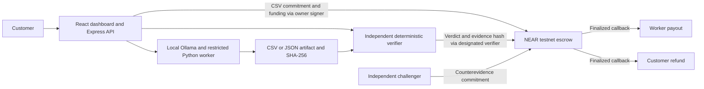

# Writbound

**Autonomous work. Binding accountability.**

AI agents can produce a deliverable quickly. Paying for that work still requires a way to check the result and resolve a dispute. Writbound runs CSV cleaning, JSON transformation, and data quality audits locally with reproducible verification. Its historical CSV demonstration traces verified and challenged work through NEAR testnet escrow to payout and refund.

## How it works

1. **Specify the work.** The customer provides a CSV or JSON dataset and versioned rules. The local API validates the input, hashes its bytes, and records a canonical specification hash.
2. **Run the worker.** Local Ollama `qwen2.5:3b` proposes a structured plan. Python validates it and executes only permitted operations using the declared arguments. The worker writes the artifact and records its SHA-256.
3. **Verify the result.** A separate deterministic implementation reconstructs the expected output from the original input and rules. It compares exact CSV bytes or canonical JSON content and reports the first mismatch. This check runs offchain.
4. **Attest or challenge.** The designated verifier commits its verdict and evidence hash to NEAR. An eligible challenger can commit reproducible counterevidence before the challenge deadline. An upheld challenge can make the customer eligible for a refund.
5. **Settle escrow.** The NEAR contract enforces signer roles, deadlines and transfer state. A verified job can pay the worker after its challenge window. A refundable job can return escrow to the customer. A successful finalized callback records the terminal state.

The model sees operation settings and returns a plan. The application controls paths, arguments and execution. The chain stores commitments and escrow state. The designated verifier is trusted to interpret offchain evidence.

## Architecture



| Layer | Technology |
|---|---|
| Dashboard | React, TypeScript, Vite, Tailwind CSS |
| Local API and journal | Node.js, Express, SQLite |
| Agent and verifier | Ollama, Python, pandas for restricted execution, independent Python reference implementation for verification |
| Escrow | Rust, near-sdk, NEAR testnet |

## Local setup on Windows

Use PowerShell, Node.js 24.8 or later with npm, Python 3.13, and Ollama. Rust and Microsoft C++ Build Tools are needed only to test or build the contract. Install and start Ollama locally. [Ollama for Windows](https://docs.ollama.com/windows)

Clone the repository and open its directory before running the commands below. Python installation must include the Windows `py` launcher. The initial npm, Python, and model downloads require internet access and local disk space. The worker's model request uses loopback only.

From the project root:

```powershell
ollama pull qwen2.5:3b
npm ci
py -3.13 -m venv .venv
.venv/Scripts/python.exe -m pip install -r services/worker/requirements-lock.txt
.venv/Scripts/python.exe -m pip install -e services/worker --no-deps
npm run build
node services/api/dist/server.js
```

In a second terminal at the project root:

```powershell
npm run dev:web
```

Open the [local dashboard](http://127.0.0.1:5173). The API listens on [loopback port 3001](http://127.0.0.1:3001/health) and uses the project venv by default. The local worker and existing testnet evidence require no wallet, signing credentials, private configuration or paid service. The API uses an unauthenticated testnet archival RPC for chain reads. Set `WRITBOUND_NEAR_RPC` to a compatible unauthenticated HTTPS testnet RPC if needed.

## Run the demo

On **Overview**, choose a bundled demo. In **Worker**, run Ollama, download the artifact and verify it. In **Challenges**, check the defective fixture to reproduce the first mismatch. In **Treasury**, check finalized Jobs #1 and #2 to view the historical CSV settlement and refund receipts. [Task specifications and fixtures](docs/TASK_TYPES.md)

Run the CSV flow and read both existing onchain jobs from a third terminal:

```powershell
node scripts/smoke-phase4.mjs
```

For all three local task workflows, with the API and Ollama running, execute `node scripts/smoke-tasks.mjs`. Each run saves the real model plan, downloaded artifact, passing verification, and defective-artifact rejection under `data/task-smoke/`.

The demo creates a fresh local job and reads existing chain state. The intentionally defective artifact omits `002,Bob,Unassigned`. Its positive onchain attestation was deliberately seeded to demonstrate a challenge against a trusted verifier's incorrect verdict. The independent verifier correctly rejects it.

## Testnet evidence

Contract account `writbound-escrow-20261105.testnet`.

| Workflow | Final state | Finalized payment |
|---|---|---|
| Job 1, correct AI-generated CSV | `Paid` after the full one-hour challenge window | [0.01 NEAR worker payout](https://testnet.nearblocks.io/txns/5LsHwiapTRiAncof3WBbUxbw8J9vXRKkdp9WmJeusXf) |
| Job 2, defective fixture and upheld challenge 0 | `Refunded` | [0.01 NEAR customer refund](https://testnet.nearblocks.io/txns/Dd3hyXRQFKWNobm1WSZNBDjkCD6PgS1kKJmqzwr9qnHL) |

[All transaction links, artifact hashes and finalized transfer/callback receipts](docs/ONCHAIN_EVIDENCE.md) · [Technical execution report and balances](docs/PHASE4_ONCHAIN_REPORT.md) · [3–4 minute recording script](docs/DEMO_SCRIPT.md)

## Testing

```powershell
npm test
node --test apps/web/test/*.test.ts
$env:WRITBOUND_TEST_LIVE = '1'
.venv/Scripts/python.exe -m unittest discover -s services/worker/tests -v
npm run build
npm run test:smoke
. ./scripts/enter-msvc.ps1
cargo test --locked --manifest-path contracts/writbound-escrow/Cargo.toml
```

Set `WRITBOUND_TEST_LIVE` only when Ollama is running and the model is available. The editable worker installation makes its Python package available to the test command. The contract test command runs locally. [Current release candidate checks](docs/RELEASE_CANDIDATE_010.md) · [Earlier release audit](docs/RELEASE_AUDIT.md)

## Security and limits

- The deterministic verifier runs independently of the AI plan, but the contract trusts the designated verifier's verdict and challenge adjudication. Participants must be able to retrieve the committed artifacts and reports.
- The API and dashboard are intended for a trusted local machine. Input sizes and tool restrictions bound the demo workload. The application holds no signing keys and the release runners block broadcasting.
- The deployment is a hackathon testnet prototype. Free RPC availability, signer custody, and NEAR transfer/callback liveness remain operational dependencies. Job 0 remains open past its deadline with its original escrow.

[Security model](docs/SECURITY_MODEL.md) · [Escrow state machine](docs/ESCROW_STATE_MACHINE.md) · [Worker and artifact format](docs/PHASE3_WORKER.md)
